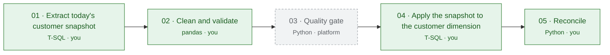

# Dimension with history (SCD2): Cleaning Up the Customer Feed Before It Hits the Warehouse

> **What I built:** I wrote the source extract in T-SQL, cleaning and quarantine in pandas, an SCD2 dimension load in T-SQL that is safe to re-run and a reconciliation report in Python.  
> **Result:** 20,536 source rows → 20,400 accepted, 136 quarantined with a reason; 600 new and 1,000 changed customers; checks: source = accepted + rejected, one current version per customer ✓.  
> **Stack:** T-SQL, pandas, Python · **Difficulty:** 5.4/10 (Junior task)  

A practice case from PipelineFab, a data-engineering practice platform: the scenario, its synthetic data and the business rules come from the platform; the code in `src/` is the solution implemented for this case, and the results were produced by running its checks. Stages the platform wrote are named as such and not included.

## Architecture

Green stages are mine; grey dashed stages were provided by the platform.

| Stage | Task | Tool | Written by | Code |
|---|---|---|---|---|
| 01 | Extract today's customer snapshot | T-SQL | **Me** | [`src/01_extract.sql`](src/01_extract.sql) |
| 02 | Clean and validate | pandas | **Me** | [`src/02_transform.py`](src/02_transform.py) |
| 03 | Quality gate | Python | Provided by PipelineFab | — |
| 04 | Apply the snapshot to the customer dimension | T-SQL | **Me** | [`src/04_load.sql`](src/04_load.sql) |
| 05 | Reconcile | Python | **Me** | [`src/05_reconcile.py`](src/05_reconcile.py) |

## Engineering decisions

**How did you detect that a record had really changed — column by column, a hash, or something else? Why that way?**

I compared the columns directly with the current customer record in the warehouse. I checked Country, City, and CreditTier because changes in these fields need a new historical version. I also cleaned the values before comparing them, so small differences like extra spaces or country names written in different ways would not create unnecessary records. I chose this method because it is simple to understand and easy to check.

**How did you close the old version and open the new one — one MERGE, or separate UPDATE and INSERT statements? What made you choose it?**

I used separate UPDATE and INSERT statements. First, I closed the old version by setting IsCurrent to 0 and updating the expiry date. Then I inserted a new version with the updated values. I chose this approach because I could control each step and keep the customer history clear. For changes to names only, I updated the existing record without creating a new version.

**When the same record arrived more than once, how did you pick the one that wins, and how did you implement it?**

I used the customer ID and loaded_at date to find the latest record for each customer. I sorted the records and used drop_duplicates to keep the newest version. Older records and duplicate copies were moved to a separate quarantine file with a reason. This way, I could keep the customer data clean without losing the original records.

**Which numbers did your reconciliation compare, and why are those the ones that prove the load is right?**

I compared the number of source, accepted, and rejected records to make sure no rows were lost. I also checked how many customers were new, changed, or unchanged after the load. Finally, I checked the total dimension rows and made sure each customer had exactly one current version. These checks helped me confirm that the data was loaded correctly and the customer history was kept.

**What would it take to make sure this feed stays clean on its own instead of needing a manual pass every time?**

I would run the same cleaning and validation steps automatically for every new batch. I would also keep rejected records in a separate file with clear reasons, so the data team could review them later. Adding alerts for unexpected errors or large numbers of rejected records would make the process more reliable. This would reduce manual work and help keep the warehouse data consistent.

## Data, before and after

A few rows as they arrived, and the same records after my transform:

**Raw**

| customer_id | company_name | contact_name | country | city | credit_limit | loaded_at |
|---|---|---|---|---|---|---|
| 27 | Company 27 | Peter Clark | Korea | Seoul | *(empty)* | 2024-07-01 01:00:25 |
| 71 | `  Company 71 ` | `Alice Chen ` | `  Poland ` | `Warsaw  ` | 89266.00 | 2024-07-01 01:01:09 |
| 149 | `  Company 149  ` | *(empty)* | ` Mexico ` | `  Mexico City  ` | 50490.00 | 2024-07-01 01:02:26 |

**Clean**

| customer_id | company_name | contact_name | country | city | credit_tier |
|---|---|---|---|---|---|
| 27 | Company 27 | Peter Clark | South Korea | Seoul | Bronze |
| 71 | Company 71 | Alice Chen | Poland | Warsaw | Platinum |
| 149 | Company 149 | *(empty)* | Mexico | Mexico City | Platinum |

Rows I quarantined, one example per reason (never deleted):

| customer_id | company_name | contact_name | country | city | credit_limit | loaded_at | reject_reason |
|---|---|---|---|---|---|---|---|
| 88 | Company 88 | *(empty)* | China | Beijing | 8274.00 | 2024-06-27 01:01:25 | superseded by a newer version |

Synthetic data generated by PipelineFab.

## Data quality evidence

The quality gate (03 · Quality gate, provided by PipelineFab) checked the output of my cleaning stage. Its thresholds are the platform's; the data it measured is mine:

| Check | Measured | Must be | Result |
|---|---|---|---|
| Reject rate (rejected ÷ source) | 0.66% | ≤ 2% | ✓ pass |
| Accepted rows missing a business key | 0 | must be 0 | ✓ pass |
| Duplicate keys among accepted rows | 0 | must be 0 | ✓ pass |

What my cleaning stage quarantined, by reason (a row with several problems counts under each):

| Reason | Rows |
|---|---|
| superseded by a newer version | 136 |

136 rows in quarantine. The rows themselves are not published.

## Results

From `outputs/reconciliation_report.json`, produced by my reconciliation stage:

| Measure | Value |
|---|---|
| Source rows | 20,536 |
| Accepted rows | 20,400 |
| Rejected rows | 136 |
| Source balances | yes |
| New customers | 600 |
| Changed customers | 1,000 |
| Unchanged customers | 18,800 |
| Dimension rows | 25,690 |
| Current rows | 20,600 |
| One current per customer | yes |

## Validation

Every stage passed PipelineFab's automated checks on 2026-11-04. What was checked on my stages:

- **01 · Extract today's customer snapshot:** columns and types match the agreed contract; the output matches a verified result I never saw.
- **02 · Clean and validate:** columns and types match the agreed contract; every source row ends up either accepted or rejected, none lost or duplicated; the output matches a verified result I never saw.
- **04 · Apply the snapshot to the customer dimension:** columns and types match the agreed contract; the history is consistent (SCD2 integrity); running it a second time leaves exactly the same result; the output matches a verified result I never saw.
- **05 · Reconcile:** columns and types match the agreed contract; the reconciliation figures agree with the data.

## What I practised

- Cleaning and standardising values
- De-duplication, latest version wins
- Slowly changing dimension (SCD2)
- Load that is safe to run twice
- Reconciliation of counts and totals

## Details

The request from the business (fictional)

> Hey, I could use your help getting our customer records ready before the nightly load picks them up. The extract from the regional systems keeps coming in with messy formatting on names and addresses, and country names are written differently depending on which office entered them. It's making it hard to trust what we're loading downstream.
>
> On top of that, we're seeing customers show up more than once across the recent drops, and some of those look like older versions of the same customer that got updated later but never removed from the feed. I need the file trimmed down so only the latest, cleanest version of each customer makes it through before we hand it off.
>
> Can you take a pass at this and let me know what you find?

Business rules as given in the request

- An accepted customer must have a numeric customer id and a country.
- Countries are stored with their standard English names. Some systems write them differently: 'USA' = United States, 'U.S.' = United States, 'UK' = United Kingdom, 'Great Britain' = United Kingdom, 'Deutschland' = Germany, 'Holland' = Netherlands, 'Korea' = South Korea, 'Espana' = Spain. A different spelling of the same country is not a change.
- Some systems pad text with spaces; stored values must not have leading or trailing spaces. A value that only differs by padding is not a change.
- credit_tier comes from credit_limit: 50,000 or more = Platinum, 20,000 or more = Gold, 5,000 or more = Silver, anything lower — or no credit limit at all — = Bronze. The limit itself is not stored, so a new limit in the same tier is not a change.
- When the same customer id appears with different loaded_at times, the most recently loaded version is the one that counts; the older versions go to quarantine.
- The dimension keeps history, and today's batch date is 2024-07-01. Country, City and CreditTier are tracked: when any of them differs from the customer's current version, that version is closed (ExpiryDate = 2024-06-30, IsCurrent = 0) and a new current version starts on 2024-07-01 (ExpiryDate empty, IsCurrent = 1).
- CompanyName and ContactName are corrected in place on the current version; on their own they never create a new version.
- A customer seen for the first time gets one current version starting on 2024-07-01. A customer that is not in today's snapshot is left exactly as it is. A customer with nothing to change gets no new row.
- Rejected rows are never deleted — they go to quarantine with a short reason.

Inputs and outputs of every stage

**01 · Extract today's customer snapshot**  
Writes `raw/customers.csv`

**02 · Clean and validate**  
Reads `raw/customers.csv` → writes `outputs/clean_customers.csv`, `quarantine/rejected_customers.csv`

**03 · Quality gate** *(provided by PipelineFab)*  
Reads `raw/customers.csv`, `outputs/clean_customers.csv`, `quarantine/rejected_customers.csv` → writes `outputs/quality_report.json`, `quarantine/gate_quarantine.csv`

**04 · Apply the snapshot to the customer dimension**  
Reads `outputs/clean_customers.csv` → writes `scn.DimCustomer`

**05 · Reconcile**  
Reads `raw/customers.csv`, `outputs/clean_customers.csv`, `quarantine/rejected_customers.csv`, `scn.DimCustomer` → writes `outputs/reconciliation_report.json`

Data contracts of my outputs

**raw/customers.csv**

| Column | Type | Can be empty | Key |
|---|---|---|---|
| customer_id | string | yes |  |
| company_name | string | yes |  |
| contact_name | string | yes |  |
| country | string | yes |  |
| city | string | yes |  |
| credit_limit | string | yes |  |
| loaded_at | string | no |  |

**outputs/clean_customers.csv**

| Column | Type | Can be empty | Key |
|---|---|---|---|
| customer_id | int | no | key |
| company_name | string | no |  |
| contact_name | string | yes |  |
| country | string | no |  |
| city | string | yes |  |
| credit_tier | string | no |  |

**quarantine/rejected_customers.csv**

| Column | Type | Can be empty | Key |
|---|---|---|---|
| customer_id | string | yes |  |
| company_name | string | yes |  |
| contact_name | string | yes |  |
| country | string | yes |  |
| city | string | yes |  |
| credit_limit | string | yes |  |
| loaded_at | string | yes |  |
| reject_reason | string | no |  |

**scn.DimCustomer**

| Column | Type | Can be empty | Key |
|---|---|---|---|
| CustomerID | int | no | key |
| CompanyName | string | no |  |
| ContactName | string | yes |  |
| Country | string | no |  |
| City | string | yes |  |
| CreditTier | string | no |  |
| EffectiveDate | date | no | key |
| ExpiryDate | date | yes |  |
| IsCurrent | int | no |  |

Running it

**Level: showcase.** The code ran inside PipelineFab, which prepared the databases, loaded CSV outputs into `landing.*` tables for the SQL stages and ran the platform stages. It is published to be read, not to be run as is.

Environment it ran in: SQL Server, Python 3 + pandas.

Names from the platform's environment were shortened for readability: `PipelineFab_DW` → `DW`, `PipelineFab_Staging` → `Staging`, `scn.p003_DimCustomer` → `scn.DimCustomer`, `scn.p003_customers_snapshot` → `scn.customers_snapshot`.

