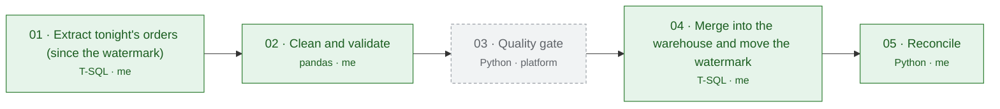

# Incremental load: Cleaning up the weekly orders feed

> **What I built:** I wrote the source extract in T-SQL, cleaning and quarantine in pandas, an incremental load in T-SQL that is safe to re-run and a reconciliation report in Python.  
> **Result:** 6,605 source rows → 6,459 accepted, 146 quarantined with a reason; checks: source = accepted + rejected ✓.  
> **Stack:** T-SQL, pandas, Python · **Level:** junior task (5.5/10 on the platform's difficulty scale)  

A practice case from [PipelineFab](https://acbworkspace.netlify.app/#tours), the data-engineering practice platform I built for myself. The platform generates the scenario, its synthetic data and the business rules, and runs a standard quality gate; the code in `src/` and the results are mine. Stages that come with the platform are named as such and not included.

## Architecture

Green stages are mine; grey dashed stages come with the platform.

| Stage | Task | Tool | Written by | Code |
|---|---|---|---|---|
| 01 | Extract tonight's orders (since the watermark) | T-SQL | **Me** | [`src/01_extract.sql`](src/01_extract.sql) |
| 02 | Clean and validate | pandas | **Me** | [`src/02_transform.py`](src/02_transform.py) |
| 03 | Quality gate | Python | Platform (built in) | — |
| 04 | Merge into the warehouse and move the watermark | T-SQL | **Me** | [`src/04_load.sql`](src/04_load.sql) |
| 05 | Reconcile | Python | **Me** | [`src/05_reconcile.py`](src/05_reconcile.py) |

## Engineering decisions

**How does your load pick up only the new rows, and what happens to the watermark if the load fails halfway?**

The extract only selects rows whose loaded_at is later than last_loaded_at in the watermark table. I used > and not >=, because rows loaded in exactly that second belong to the previous run. In the load, moving the watermark is in the same transaction as the warehouse update, so if anything fails, everything rolls back and the watermark stays where it was.

**When the same order arrived more than once, which one did you keep?**

I checked duplicates on order_id, kept the first copy and sent the others to quarantine with a reason. In this batch every repeated order was an exact copy, so keeping the first one was safe.

**How did you make sure every row is either accepted or rejected, and nothing is counted twice?**

In the transform I gave every row a set of reject flags. A row with at least one flag goes to the rejected file, every other row goes to the clean file, so each row lands in exactly one of them. The reconciliation then checks that source rows = accepted + rejected. In the warehouse, NOT EXISTS stops an order from being inserted twice, and the update only touches orders whose values really changed (IS DISTINCT FROM).

**Which numbers did your reconciliation compare?**

Source, accepted and rejected rows, and that the first equals the other two together. Then I merged the clean orders with the loaded warehouse table on the order id (order_id on one side, OrderID on the other) and counted the matches: every accepted order must be in the warehouse, with its amount within 0.01. Finally the watermark must equal the latest loaded_at I extracted.

**Which problem rows should be corrected and kept, and which set aside for the partner?**

Rows I can fix with a clear rule I correct and keep, like order dates that arrive in different formats. When the data itself is in conflict, for example the same order arriving twice with different amounts, I can't know which one is right, so I would set it aside and ask the partner. Rejected rows are never deleted; each one keeps a reason.

**What was the hardest part?**

The incremental load in SQL, and the watermark most of all. It was my first time, and keeping the old and the new watermark value apart in my head was confusing. Emptying the landing tables with TRUNCATE before each load was another detail I learned here. In pandas I used merge with left_on / right_on and how="left" for the first time, and reading data from SQL Server into a DataFrame with pyodbc was also new; I had some help with those lines.

## Data, before and after

Rows I quarantined, one example per reason (never deleted):

| order_id | customer_id | employee_id | order_date | status | total_amount | currency | source_system | loaded_at | reject_reason |
|---|---|---|---|---|---|---|---|---|---|
| 114062 | *(empty)* | 115 | 08/22/2022 | Processing | 297.73 | CAD | WEB_SHOP | 2024-07-01 01:01:01 | Invalid CustomerID |
| 114155 | 120 | 56 | 2022-09-01 | Shipped | 0.00 | USD | ERP | 2024-07-01 01:02:34 | Invalid Amount |
| 114680 | 186 | 146 | 2022-10-27 | Processing | 3386.63 | USD | ERP | 2024-07-01 01:11:19 | Duplicated Order |

Synthetic data generated by PipelineFab.

## Data quality evidence

The quality gate (03 · Quality gate, built into the platform) checked the output of my cleaning stage. Its thresholds are the platform's; the data it measured is mine:

| Check | Measured | Must be | Result |
|---|---|---|---|
| Reject rate (rejected ÷ source) | 2.21% | ≤ 4% | ✓ pass |
| Accepted rows missing a business key | 0 | must be 0 | ✓ pass |
| Duplicate keys among accepted rows | 0 | must be 0 | ✓ pass |

What my cleaning stage quarantined, by reason (a row with several problems counts under each):

| Reason | Rows |
|---|---|
| Invalid CustomerID | 52 |
| Invalid Amount | 49 |
| Duplicated Order | 45 |

146 rows in quarantine. The rows themselves are not published.

## Results

From `outputs/reconciliation_report.json`, produced by my reconciliation stage:

| Measure | Value |
|---|---|
| Source rows | 6,605 |
| Accepted rows | 6,459 |
| Rejected rows | 146 |
| Fact rows | 19,906 |
| Source balances | yes |
| Accepted in fact | yes |
| Watermark | 2024-07-01 02:49:19 |
| Watermark is latest | yes |

## Validation

Every stage passed the platform's automated checks on 2026-11-26. What was checked on my stages:

- **01 · Extract tonight's orders (since the watermark):** columns and types match the agreed contract; the output matches the platform's reference result, which stays hidden while I work.
- **02 · Clean and validate:** columns and types match the agreed contract; the output matches the platform's reference result, which stays hidden while I work; every source row ends up either accepted or rejected, none lost or duplicated.
- **04 · Merge into the warehouse and move the watermark:** columns and types match the agreed contract; running it a second time leaves exactly the same result; the output matches the platform's reference result, which stays hidden while I work.
- **05 · Reconcile:** columns and types match the agreed contract; the reconciliation figures agree with the data.

## What I practised

- Cleaning and standardising values
- De-duplication, latest version wins
- Quarantine with a reason
- Incremental load (watermark)
- Load that is safe to run twice
- Reconciliation of counts and totals

## Details

The request from the business (fictional)

> Our storefront partner sends us a batch of orders every week, and the file has become hard to trust. Dates arrive written in several different styles depending on which system produced the row, and some orders seem to show up more than once.
>
> A few rows also arrive without the identifier we use to tell orders apart, so nobody downstream can match them to anything. Finance reads this feed first thing in the morning and needs a tidy, consistent version they can rely on.
>
> Could you prepare the feed so it is clean and consistent? Please keep anything you set aside visible, so we can go back to the partner with questions.

Business rules as given in the request

- An accepted order must have a numeric order id, a numeric customer id, a valid order date and a valid amount.
- Every order must name its customer; an order without a customer id is rejected.
- Dates arrive in several formats (year-month-day, month/day/year, and day-abbreviated month-year). Store them as calendar dates, YYYY-MM-DD.
- An amount that is missing, not a number, zero or negative makes the record invalid; it is rejected.
- Status must be one of: Pending, Processing, Shipped, Delivered, Cancelled.
- Sometimes the same order is delivered twice, identical. Keep one copy; the extra copies go to quarantine.
- Amounts stay in their original currency; keep the currency code.
- Rejected rows are never deleted — they go to quarantine with a short reason.

Inputs and outputs of every stage

**01 · Extract tonight's orders (since the watermark)**  
Only the query: stage 02 runs it and writes the extract file

**02 · Clean and validate**  
Runs the query from stage 01, writes `raw/orders.csv`, `outputs/clean_orders.csv`, `quarantine/rejected_orders.csv`

**03 · Quality gate** *(built into the platform)*  
Reads `raw/orders.csv`, `outputs/clean_orders.csv`, `quarantine/rejected_orders.csv` → writes `outputs/quality_report.json`, `quarantine/gate_quarantine.csv`

**04 · Merge into the warehouse and move the watermark**  
Reads `outputs/clean_orders.csv`, `raw/orders.csv` → writes `scn.FactOrders`, `scn.etl_watermark`

**05 · Reconcile**  
Reads `raw/orders.csv`, `outputs/clean_orders.csv`, `quarantine/rejected_orders.csv`, `outputs/loaded_orders.csv` (export of `scn.FactOrders`), `outputs/etl_watermark.csv` (export of `scn.etl_watermark`) → writes `outputs/reconciliation_report.json`

Data contracts of my outputs

**raw/query/orders.csv**

| Column | Type | Can be empty | Key |
|---|---|---|---|
| order_id | string | no |  |
| customer_id | string | yes |  |
| employee_id | string | yes |  |
| order_date | string | yes |  |
| status | string | yes |  |
| total_amount | string | yes |  |
| currency | string | yes |  |
| source_system | string | yes |  |
| loaded_at | string | yes |  |

**raw/orders.csv**

| Column | Type | Can be empty | Key |
|---|---|---|---|
| order_id | string | no |  |
| customer_id | string | yes |  |
| employee_id | string | yes |  |
| order_date | string | yes |  |
| status | string | yes |  |
| total_amount | string | yes |  |
| currency | string | yes |  |
| source_system | string | yes |  |
| loaded_at | string | yes |  |

**outputs/clean_orders.csv**

| Column | Type | Can be empty | Key |
|---|---|---|---|
| order_id | int | no | key |
| customer_id | int | no |  |
| employee_id | int | yes |  |
| order_date | date | no |  |
| status | string | no |  |
| total_amount | decimal(12,2) | no |  |
| currency_code | string | no |  |
| source_system | string | yes |  |

**quarantine/rejected_orders.csv**

| Column | Type | Can be empty | Key |
|---|---|---|---|
| order_id | string | yes |  |
| customer_id | string | yes |  |
| employee_id | string | yes |  |
| order_date | string | yes |  |
| status | string | yes |  |
| total_amount | string | yes |  |
| currency | string | yes |  |
| source_system | string | yes |  |
| loaded_at | string | yes |  |
| reject_reason | string | no |  |

**scn.FactOrders**

| Column | Type | Can be empty | Key |
|---|---|---|---|
| OrderID | int | no | key |
| DateKey | int | no |  |
| CustomerKey | int | no |  |
| EmployeeID | int | yes |  |
| OrderStatus | string | no |  |
| Amount | decimal(12,2) | no |  |
| CurrencyCode | string | no |  |
| SourceSystem | string | yes |  |

**scn.etl_watermark**

| Column | Type | Can be empty | Key |
|---|---|---|---|
| source_name | string | no | key |
| last_loaded_at | string | no |  |

Running it

**Showcase only.** The code ran inside PipelineFab, which prepared the databases and ran the platform stages; my load script fills its `landing.*` tables from the CSV files itself (BULK INSERT). `$(WorkspaceDir)` in the code is the folder the pipeline ran in, filled in before the script runs (like a SQLCMD variable). It is published to be read, not to be run as is.

Environment it ran in: SQL Server, Python 3 + pandas.

Names from the platform's environment were shortened for readability: `PipelineFab_DW` → `DW`, `PipelineFab_Staging` → `Staging`, `scn.p004_FactOrders` → `scn.FactOrders`, `scn.p004_etl_watermark` → `scn.etl_watermark`, `scn.p004_orders_feed` → `scn.orders_feed`.

